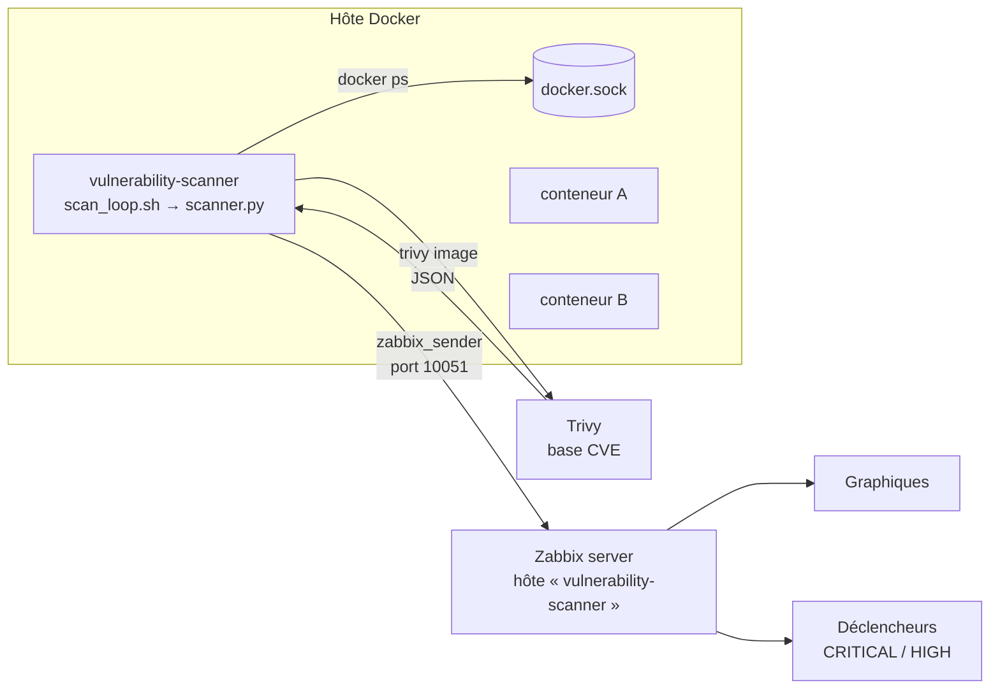

# Scanner de vulnérabilités Docker → Zabbix

**Scanne chaque heure les images de tous les conteneurs en cours d'exécution avec Trivy et remonte le nombre de failles par sévérité dans Zabbix, pour alerter dès qu'une CVE critique apparaît.**


Les images d'une infrastructure vieillissent : une image saine le jour du déploiement accumule des CVE au fil des mois. Ce conteneur fait le tour des images en service, les passe dans Trivy et transforme le résultat en métriques Zabbix : historique, graphiques et déclencheurs d'alerte, dans l'outil de supervision déjà en place.

---

## Fonctionnement



1. `scan_loop.sh` lance `scanner.py` toutes les `SCAN_INTERVAL` secondes (1 h par défaut).
2. `scanner.py` liste les conteneurs via le socket Docker (en ignorant le sien) et scanne chaque image **une seule fois**, même si plusieurs conteneurs l'utilisent.
3. Les vulnérabilités sont comptées par sévérité et additionnées pour toute l'infrastructure.
4. Les totaux partent vers Zabbix en mode **trapper** (aucun agent ni interface à configurer côté hôte).

## Métriques envoyées

| Clé Zabbix | Valeur |
|---|---|
| `vuln.critical` | Vulnérabilités CRITICAL (toutes images) |
| `vuln.high` | Vulnérabilités HIGH |
| `vuln.medium` | Vulnérabilités MEDIUM |
| `vuln.low` | Vulnérabilités LOW |
| `vuln.total` | Total, toutes sévérités |
| `vuln.containers.scanned` | Nombre d'images distinctes scannées |

---

## Démarrage rapide

```bash
git clone https://github.com/LOIC-only-one/Script-Image-Scanner-Docker-zabbix.git
cd Script-Image-Scanner-Docker-zabbix
docker build -t vulnerability-scanner .

docker run -d --name vulnerability-scanner \
  -v /var/run/docker.sock:/var/run/docker.sock:ro \
  -e ZABBIX_SERVER=<ip-du-serveur-zabbix> \
  vulnerability-scanner

docker logs -f vulnerability-scanner
```

Ou dans un `docker-compose.yml` existant :

```yaml
services:
  vulnerability-scanner:
    build: ./Script-Image-Scanner-Docker-zabbix
    container_name: vulnerability-scanner   # ce nom est exclu du scan
    restart: unless-stopped
    volumes:
      - /var/run/docker.sock:/var/run/docker.sock:ro
    environment:
      ZABBIX_SERVER: zabbix-server
      SCAN_INTERVAL: 3600
```

> Le socket Docker donne un accès étendu à l'hôte : à monter en lecture seule et à réserver à un conteneur de confiance.

## Variables d'environnement

| Variable | Défaut | Rôle |
|---|---|---|
| `ZABBIX_SERVER` | `172.23.0.20` | Adresse du serveur Zabbix |
| `ZABBIX_PORT` | `10051` | Port trapper |
| `SCANNER_HOSTNAME` | `vulnerability-scanner` | Nom de l'hôte dans Zabbix |
| `SCAN_INTERVAL` | `3600` | Secondes entre deux scans |

---

## Configuration dans Zabbix (à faire manuellement)

### 1. Créer l'hôte dans Zabbix

1. Allez dans **Configuration** → **Hôtes** → **Créer un hôte**
2. Configurez :
   - **Nom d'hôte** : `vulnerability-scanner`
   - **Nom visible** : `Scanner de Vulnérabilités`
   - **Groupes** : Créez ou sélectionnez `Security/Scanners`
   - **Interfaces** : Aucune interface n'est nécessaire (trapper uniquement)

### 2. Créer le template (optionnel mais recommandé)

1. Allez dans **Configuration** → **Templates** → **Créer un template**
2. Nom : `Template Vulnerability Scanner`
3. Groupes : `Templates/Security`

### 3. Créer les items (données)

Pour chaque métrique, créez un item de type **Zabbix trapper** :

#### Item 1 : Vulnérabilités Critiques
- **Nom** : `Vulnérabilités CRITICAL`
- **Type** : `Zabbix trapper`
- **Clé** : `vuln.critical`
- **Type d'information** : `Entier non signé`
- **Unités** : (vide)
- **Applications/Tags** : `Security`, `Vulnerabilities`

#### Item 2 : Vulnérabilités HIGH
- **Nom** : `Vulnérabilités HIGH`
- **Type** : `Zabbix trapper`
- **Clé** : `vuln.high`FROM alpine:3.19

# Installation des dépendances
RUN apk add --no-cache \
    python3 \
    py3-pip \
    docker-cli \
    zabbix-utils \
    bash \
    curl

# Installation de Trivy
RUN curl -sfL https://raw.githubusercontent.com/aquasecurity/trivy/main/contrib/install.sh | sh -s -- -b /usr/local/bin

# Création du répertoire de travail
WORKDIR /scanner

# Copie des scripts
COPY scanner.py /scanner/
COPY scan_loop.sh /scanner/

RUN chmod +x /scanner/scan_loop.sh

# Lancement du scanner en boucle
CMD ["/scanner/scan_loop.sh"]

- **Type d'information** : `Entier non signé`
- **Unités** : (vide)
- **Applications/Tags** : `Security`, `Vulnerabilities`

#### Item 3 : Vulnérabilités MEDIUM
- **Nom** : `Vulnérabilités MEDIUM`
- **Type** : `Zabbix trapper`
- **Clé** : `vuln.medium`
- **Type d'information** : `Entier non signé`
- **Unités** : (vide)
- **Applications/Tags** : `Security`, `Vulnerabilities`

#### Item 4 : Vulnérabilités LOW
- **Nom** : `Vulnérabilités LOW`
- **Type** : `Zabbix trapper`
- **Clé** : `vuln.low`
- **Type d'information** : `Entier non signé`
- **Unités** : (vide)
- **Applications/Tags** : `Security`, `Vulnerabilities`

#### Item 5 : Total des vulnérabilités
- **Nom** : `Total des vulnérabilités`
- **Type** : `Zabbix trapper`
- **Clé** : `vuln.total`
- **Type d'information** : `Entier non signé`
- **Unités** : (vide)
- **Applications/Tags** : `Security`, `Vulnerabilities`

#### Item 6 : Conteneurs scannés
- **Nom** : `Nombre de conteneurs scannés`
- **Type** : `Zabbix trapper`
- **Clé** : `vuln.containers.scanned`
- **Type d'information** : `Entier non signé`
- **Unités** : (vide)
- **Applications/Tags** : `Security`, `Monitoring`

### 4. Créer des triggers (alertes)

#### Trigger 1 : Vulnérabilités critiques détectées
- **Nom** : `Vulnérabilités CRITICAL détectées sur {HOST.NAME}`
- **Sévérité** : `Majeur` ou `Critique`
- **Expression** : 
  ```
  last(/vulnerability-scanner/vuln.critical)>0
  ```
- **Description** : `{ITEM.LASTVALUE} vulnérabilités critiques ont été détectées`

#### Trigger 2 : Vulnérabilités HIGH détectées
- **Nom** : `Vulnérabilités HIGH détectées sur {HOST.NAME}`
- **Sévérité** : `Moyen`
- **Expression** : 
  ```
  last(/vulnerability-scanner/vuln.high)>5
  ```
- **Description** : `{ITEM.LASTVALUE} vulnérabilités de haute sévérité détectées`

#### Trigger 3 : Nombre élevé de vulnérabilités totales
- **Nom** : `Nombre élevé de vulnérabilités ({ITEM.LASTVALUE})`
- **Sévérité** : `Avertissement`
- **Expression** : 
  ```
  last(/vulnerability-scanner/vuln.total)>50
  ```
- **Description** : `Plus de 50 vulnérabilités au total détectées`

### 5. Créer des graphiques (optionnel)

#### Graphique 1 : Évolution des vulnérabilités par sévérité
- **Nom** : `Vulnérabilités par sévérité`
- **Type** : `Normal`
- **Items** :
  - `vuln.critical` (Rouge)
  - `vuln.high` (Orange)
  - `vuln.medium` (Jaune)
  - `vuln.low` (Vert)

#### Graphique 2 : Total des vulnérabilités
- **Nom** : `Total des vulnérabilités`
- **Type** : `Normal`
- **Items** :
  - `vuln.total`

## Tests

Pour forcer un scan immédiat :

```bash
docker exec vulnerability-scanner python3 /scanner/scanner.py
```

## Vérification dans Zabbix

1. Allez dans **Surveillance** → **Dernières données**
2. Filtrez par hôte : `vulnerability-scanner`
3. Vous devriez voir les 6 métriques avec leurs valeurs actuelles

## Dépannage

### Le scanner ne trouve pas les conteneurs
Vérifiez que le socket Docker est bien monté :
```bash
docker inspect vulnerability-scanner | grep docker.sock
```

### Pas de données dans Zabbix
1. Vérifiez les logs du scanner :
   ```bash
   docker logs vulnerability-scanner
   ```

2. Vérifiez que le serveur Zabbix est accessible :
   ```bash
   docker exec vulnerability-scanner nc -zv 172.23.0.20 10051
   ```

3. Testez manuellement zabbix_sender :
   ```bash
   docker exec vulnerability-scanner zabbix_sender -z 172.23.0.20 -p 10051 -s vulnerability-scanner -k vuln.test -o 123
   ```

### Trivy prend trop de temps
Les premiers scans peuvent être longs car Trivy télécharge sa base de données de vulnérabilités. Les scans suivants seront plus rapides.

---

Projet de [Loïc Maurer](https://github.com/LOIC-only-one) · Supervision & sécurité
